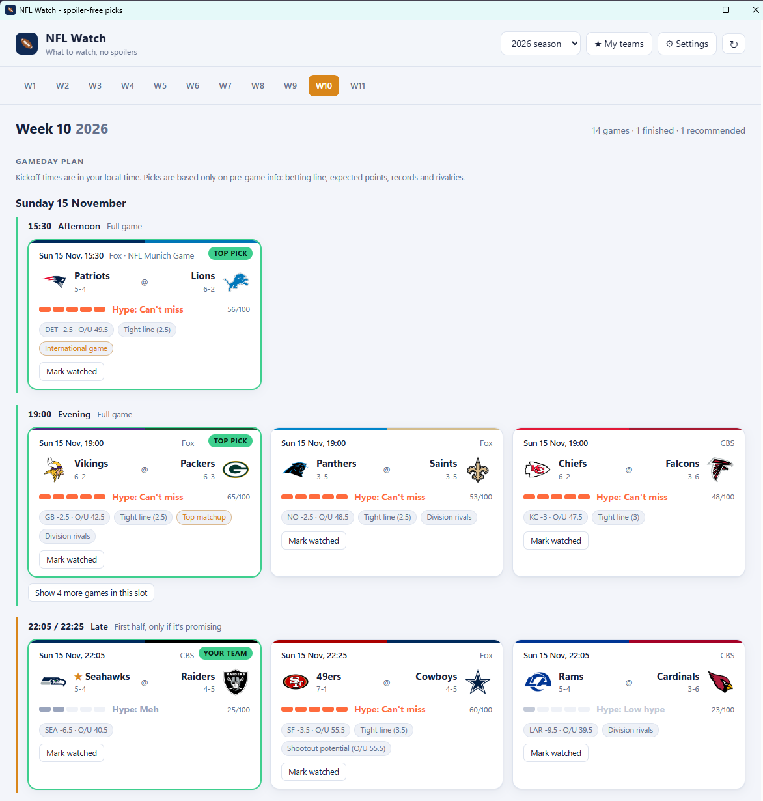

# NFL Watch

**Spoiler-free NFL game recommendations for people who watch games after they happen.**

If you watch the NFL on Game Pass from Europe, most games end in the middle of
your night. You wake up with a whole slate of replays and no idea which ones
are worth your time, and every attempt to find out risks spoiling the result.

NFL Watch rates every finished game by how *fun it was to watch*: close games,
comebacks, late drama, shootouts and upsets. It never shows you a score.
For upcoming games it builds a **gameday plan** that fits your local time zone.



---

## Features

### Spoiler-free ratings for finished games
Every finished game gets a watchability score from 0 to 100, shown as 1–5 bars:
*Skip it · Only if bored · Solid · Worth it · Must watch*.

- **Scores never reach the UI.** The Rust backend reads the results and sends
  the frontend only teams, kickoff time and the rating.
- **Pre-game records only.** ESPN's team records already include the game you
  haven't watched yet, so NFL Watch works out each team's record itself from
  earlier weeks.
- **The reasons are hidden by default.** Hints like *Overtime* or *Comeback*
  are mild spoilers, so they appear only when you click **Why this rating?**
  (or switch them on permanently in Settings).
- **Ratings for your teams can be hidden.** A low rating for your own team's
  game gives away a blowout, so there's an optional setting to hide those too.

### Gameday plan for upcoming games
Upcoming games are grouped by gameday and by kickoff slot in **your local
time**:

| Slot | Default window | What it suggests |
|---|---|---|
| Afternoon | 09:00 – 17:00 | Full game. International games in London, Munich, etc. land here |
| Evening | 17:00 – 20:30 | Full game |
| Late | 20:30 – 23:30 | First half only, and only if the game looks promising |
| Night | later | Too late to watch live; catch the replay, which gets rated after the game |

Each slot gets a **top pick** based on a pre-game **hype** score. Your favorite
team always takes the pick for its slot. All windows can be changed in Settings.

### Favorites and watch tracking
- **My teams:** your favorite teams' games always appear at the top, whatever
  their rating.
- **Mark watched:** watched games are dimmed or hidden. Once a game is marked
  as watched, **Reveal result** shows the final score.
- **Seasons and weeks:** browse the regular season and playoffs of the current
  season and the four before it.
- **Fresh data on every start:** finished games are cached, so later starts
  are fast.

---

## How the ratings work

### Watchability (after the game)
The score adds up several independent signals of entertainment value:

| Signal | Source |
|---|---|
| Final margin, ties, overtime | final result |
| **Excitement index**: total swing in win probability during the game | ESPN play-by-play win probability |
| Lead changes and ties | scoring timeline |
| Comebacks (largest deficit the winner overcame) | scoring timeline |
| Go-ahead or tying scores in the last 5 minutes or in overtime | scoring timeline |
| Underdog wins | pre-game betting line |
| Shootouts and low-scoring defensive battles | total points |
| Top matchup (two good teams) | pre-game records |

The star cutoffs were calibrated on the full 2025 season. About 15% of games
come out as *Must watch* and about 30% as *Skip it*.

### Hype (before the game)
Hype uses only information available before kickoff:
- how close the betting line is
- the expected total points (over/under)
- both teams' records so far
- top matchups
- division rivalries

Checked against the 2025 season, games rated *Can't miss* averaged 52/100
watchability afterwards, against 25/100 for *Low hype* games. That's a useful
but modest signal: plenty of great NFL games come out of nowhere, which is why
the after-game ratings stay the main feature.

### Your own weights
Under *Settings → Rating weights*, a slider for each criterion sets how much it
counts. You could ignore upsets entirely, or care twice as much about
momentum swings. The stars are recalibrated automatically, so *Must watch*
still means roughly the top 15% of games.

**[Read the full scoring documentation →](docs/scoring.md)** It covers every
component, threshold and calibration result, with worked examples.

---

## Installation

Download the installer from the releases page if one is available, or build it
yourself.

### Requirements
- Windows 10/11 with WebView2 (already included in Windows 11)
- [Rust](https://rustup.rs) (stable)
- Tauri CLI: `cargo install tauri-cli --version "^2"`

macOS and Linux should work with Tauri's usual
[prerequisites](https://v2.tauri.app/start/prerequisites/), but they have not
been tested.

### Build

```sh
git clone https://github.com/iso8859-1/nfl-watch.git
cd nfl-watch/src-tauri

cargo tauri dev      # run in development mode
cargo tauri build    # optimized build + installer
```

Release outputs:
- `src-tauri/target/release/bundle/nsis/NFL Watch_<version>_x64-setup.exe`: the installer.
  It installs for the current user only and needs no admin rights.
- `src-tauri/target/release/nfl-watch.exe`: a standalone executable.

The installer is not code-signed, so Windows SmartScreen shows "Unknown
publisher" the first time you run it. Click *More info* and then *Run anyway*.

### Android

The same code base builds an Android app. The UI switches to a compact phone
layout on narrow screens. It has been tested on a Pixel 8a running Android 17.

**Prerequisites**, in addition to Rust and the Tauri CLI:
- **Android Studio**, with these installed through the SDK Manager:
  - *SDK Platforms:* Android API 37. The generated project compiles against
    exactly this version (37.0); a 37.1 or 37.2 alone is not enough.
  - *SDK Tools:* NDK (Side by side) and Android SDK Command-line Tools
- **JDK 21**, for example Eclipse Temurin 21
- **Environment variables:**

  | Variable | Points to |
  |---|---|
  | `ANDROID_HOME` | the SDK folder, usually `%LOCALAPPDATA%\Android\Sdk` |
  | `NDK_HOME` | the versioned NDK folder, e.g. `%ANDROID_HOME%\ndk\30.0.16248370` |
  | `JAVA_HOME` | the JDK 21 folder |

  Restart your terminal after setting them.
- **Rust Android targets:**
  ```sh
  rustup target add aarch64-linux-android armv7-linux-androideabi i686-linux-android x86_64-linux-android
  ```

**Build and run.** The Android project is already generated and committed in
`src-tauri/gen/android`, so you don't need `cargo tauri android init`.

```sh
cd src-tauri
cargo tauri android dev                                  # run on a connected phone or emulator, with live reload
cargo tauri android build --debug --apk --target aarch64 # debug APK for 64-bit ARM phones
```

The debug APK ends up in
`src-tauri/gen/android/app/build/outputs/apk/universal/debug/`. To install it
on a phone with USB debugging turned on, run:

```sh
adb install -r app-universal-debug.apk
```

The first build downloads Gradle and its dependencies, so it takes a few
minutes. Debug APKs are large, about 175 MB, because the Rust code is
unoptimized.

#### Signed release build

Release APKs are signed with a key from a keystore, which is not part of this
repository. Gradle finds it through `src-tauri/gen/android/keystore.properties`,
which git ignores:

```properties
storeFile=C:/Users/<you>/.android-keystores/nfl-watch-release.jks
storePassword=...
keyAlias=nfl-watch
keyPassword=...
```

To create a keystore of your own, use the `keytool` that comes with the JDK:

```sh
keytool -genkeypair -keystore nfl-watch-release.jks -storetype PKCS12 -alias nfl-watch \
        -keyalg RSA -keysize 4096 -validity 10000 -dname "CN=Your Name"
```

Then build:

```sh
cargo tauri android build --apk --target aarch64
```

The signed APK ends up in
`src-tauri/gen/android/app/build/outputs/apk/universal/release/`. Without
`keystore.properties`, the release build still works but produces an unsigned
APK that Android won't install.

> **Back up the keystore and its password.** Android only installs an update
> if it's signed with the same key as the installed app. If the key is lost,
> users have to uninstall the app, losing their favorites and watched games,
> and install it again.

Android also refuses to install a release APK over a debug build, because the
two are signed with different keys. Uninstall the debug build first.

The app is not on the Play Store.

### Tests

```sh
cd src-tauri
cargo test
```

Two ignored tests fetch a whole season and print **only aggregate numbers**,
with no teams and no scores. You can use them to tune the formulas:

```sh
SEASON=2025 cargo test calibration -- --ignored --nocapture      # star distribution
SEASON=2025 cargo test hype_vs_rating -- --ignored --nocapture   # does hype predict watchability?
```

---

## Data and privacy

- Game data comes from ESPN's public site API. It needs no account or API key.
- Everything else stays on your machine:
  - `%APPDATA%\com.nflwatch.desktop\user-data.json`: favorites, watched games, settings
  - `%APPDATA%\com.nflwatch.desktop\cache\`: cached game data, which you can delete at any time
- On Android the same files live in the app's private storage. Clearing the
  app's storage in Android's settings removes them. Phone and desktop don't sync.

## Project layout

```
ui/                    frontend: plain HTML/CSS/JS, no build step
  index.html
  app.js
  style.css
src-tauri/
  tauri.conf.json      window, security policy (CSP), installer config
  gen/android/         generated Android Studio project
  src/
    main.rs            desktop entry point
    lib.rs             Tauri commands and spoiler-free view models; app entry point (desktop and Android)
    espn.rs            ESPN API client and disk cache
    rating.rs          watchability and hype scoring
    store.rs           favorites, watched games and settings
  data/                anonymous 2025 reference samples for calibrating custom weights
docs/                  screenshots
```

## Disclaimer

This is an unofficial hobby project. It is not affiliated with, endorsed by or
connected to the NFL, NFL Game Pass, DAZN or ESPN. Team names and logos are
trademarks of their respective owners. The ESPN API is undocumented and may
change without notice.

## License

[MIT](LICENSE)
